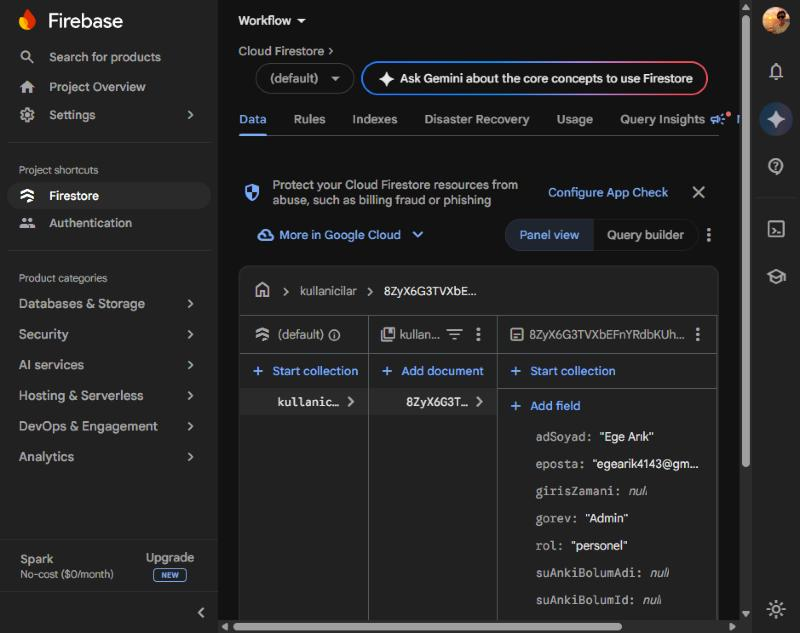

# Veritabanı Nasıl Çalışıyor?

WorkFlow, verilerini **Cloud Firestore**'da tutar. Firestore, Google'ın internet üzerindeki (bulut) veritabanıdır. Ayrı bir sunucu kurmamız gerekmez; telefon doğrudan Firestore ile konuşur.

## Koleksiyon ve doküman

Firestore'da veriler bir dosya dolabı gibi düzenlenir:

- **Koleksiyon** = çekmece (örnek: `kullanicilar`)
- **Doküman** = çekmecedeki tek bir kart (örnek: bir personelin bilgileri)
- **Alan** = kartın üzerindeki satırlar (örnek: `adSoyad: "Ege Arık"`)

Görüntüde soldan sağa:
1. `(default)` veritabanı içinde `kullanicilar` koleksiyonu var.
2. Koleksiyonun içinde bir doküman var. Dokümanın adı (`8ZyX6G3T...`) kullanıcının **uid**'sidir: Firebase Authentication'ın her hesaba verdiği benzersiz kimlik. Böylece giriş yapan kişinin bilgisini `kullanicilar/{uid}` yoluyla doğrudan buluruz.
3. Sağda dokümanın alanları:

| Alan | Örnek değer | Anlamı |
|---|---|---|
| `adSoyad` | "Ege Arık" | Kayıtta girilen ad soyad |
| `eposta` | "...@gmail.com" | Giriş e-postası (küçük harfle) |
| `gorev` | "Admin" | Kayıtta girilen görev |
| `rol` | "personel" | Kayıt olan herkes personeldir. Yönetici rolü konsoldan elle verilir. |
| `suAnkiBolumId` | null | Şu an içinde bulunduğu bölüm. `null` = hiçbir bölümde değil. QR okutulunca dolacak (Gün 3). |
| `suAnkiBolumAdi` | null | Aynı bölümün adı (ekranda göstermek için) |
| `girisZamani` | null | Bölüme giriş saati (Gün 3) |

## Kayıt olunca ne oluyor?

1. Uygulama **Firebase Authentication**'da e-posta + şifre ile bir hesap açar. Şifre burada güvenli şekilde saklanır; Firestore'da şifre **yoktur**.
2. Authentication hesaba bir **uid** verir.
3. Uygulama Firestore'da `kullanicilar/{uid}` dokümanını yukarıdaki alanlarla oluşturur.
4. Ana sayfa bu dokümanı **canlı dinler** (`snapshots()`): konsoldan bir alan değiştirilirse telefondaki ekran kendiliğinden güncellenir.

## Güvenlik kuralları

Firestore'a kimin ne yazabileceğini `firestore.rules` dosyası belirler. Şu anki kurallar:
- Giriş yapmamış biri hiçbir şey okuyamaz.
- Bir kullanıcı yalnızca **kendi** dokümanını okuyabilir.
- Kayıtta doküman yalnızca `rol: "personel"` ile oluşturulabilir. Biri uygulamayı değiştirip kendini "yonetici" yapmaya çalışsa Firestore bunu reddeder.

Sonraki günlerde eklenecek koleksiyonlar: `bolumler` (bölümler) ve `hareketler` (giriş/çıkış kayıtları).
